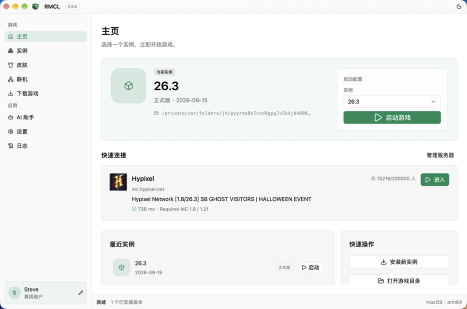
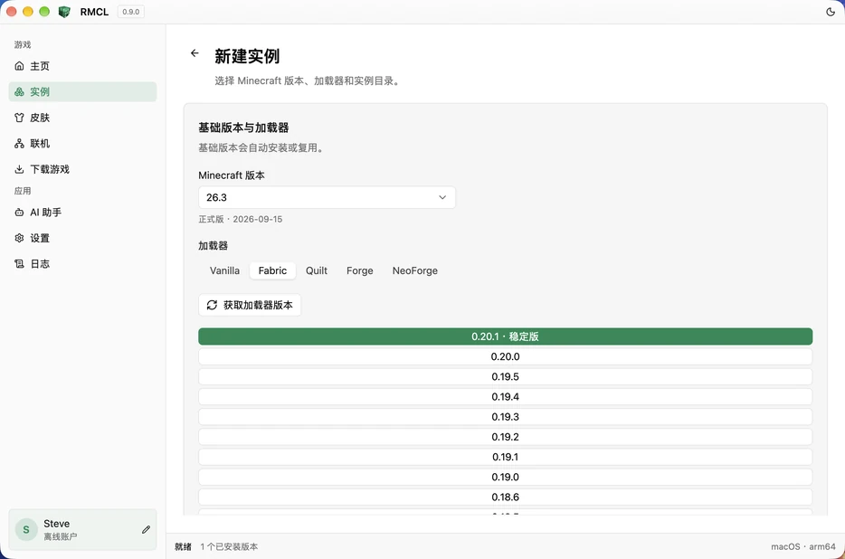
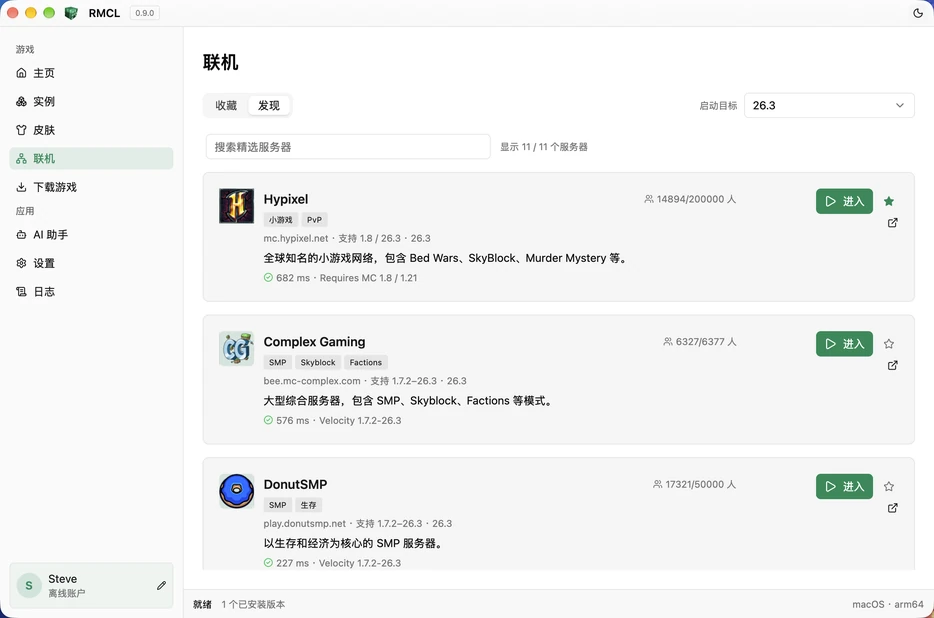
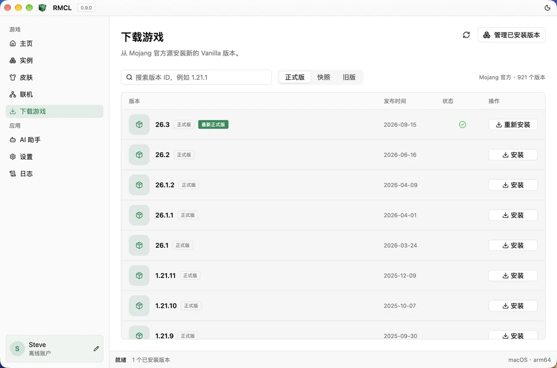

<p align="center">
  
</p>

<h1 align="center">RMCL</h1>

<p align="center">
  A modern Minecraft: Java Edition launcher built with Rust and GPUI Kit.
</p>

<p align="center">
  <a href="https://driftcell.github.io/RMCL/">官网</a> ·
  <a href="https://github.com/driftcell/RMCL/releases">下载</a>
</p>

<p align="center">
  <a href="https://github.com/driftcell/RMCL/actions/workflows/ci.yml">
    
  </a>
</p>

RMCL 是一个独立的 Minecraft Java 版启动器，使用 Rust 和 GPUI Kit 构建原生桌面界面。支持正版与离线账户、Vanilla 和主流加载器、实例隔离、Mod 管理、服务器收藏、皮肤更换与自动更新。

## 界面预览

<table>
  <tr>
    <th align="left">主页与快速启动</th>
    <th align="left">新建实例</th>
  </tr>
  <tr>
    <td>
      <picture>
        <source media="(prefers-color-scheme: dark)" srcset="web/public/screenshots/home-dark.webp">
        
      </picture>
    </td>
    <td>
      <picture>
        <source media="(prefers-color-scheme: dark)" srcset="web/public/screenshots/instances-dark.webp">
        
      </picture>
    </td>
  </tr>
  <tr>
    <th align="left">联机发现</th>
    <th align="left">下载游戏</th>
  </tr>
  <tr>
    <td>
      <picture>
        <source media="(prefers-color-scheme: dark)" srcset="web/public/screenshots/servers-dark.webp">
        
      </picture>
    </td>
    <td>
      <picture>
        <source media="(prefers-color-scheme: dark)" srcset="web/public/screenshots/downloads-dark.webp">
        
      </picture>
    </td>
  </tr>
</table>

## 下载

Release 构建由 GitHub Actions 生成，发布在 [Releases](https://github.com/driftcell/RMCL/releases)。

当前提供 macOS（Intel / Apple Silicon）、Windows x86_64 和 Linux x86_64 产物。

### macOS 首次打开

当前 macOS 产物使用 ad-hoc 签名，Gatekeeper 可能提示“已损坏”或阻止打开。解压后在终端执行：

```bash
xattr -dr com.apple.quarantine RMCL.app
open RMCL.app
```

## 从源码运行

需要 stable Rust 工具链和对应平台的 GPUI Kit 系统依赖。

```bash
cargo run -p rmcl
```

平台要求：

- macOS 15+
- Windows 10+
- Linux：Wayland/X11、Vulkan 和 GPUI Kit 文档列出的 GTK/WebKitGTK 依赖

更多构建和打包细节见 [平台与分发](docs/release/DISTRIBUTION.md)。

## 文档

完整文档见 [文档索引](docs/INDEX.md)，包括产品范围、架构、兼容性、工程约定和发布流程。

## 致谢

感谢 HMCL 在 Minecraft 启动器行为和兼容性方面提供的公开参考。
